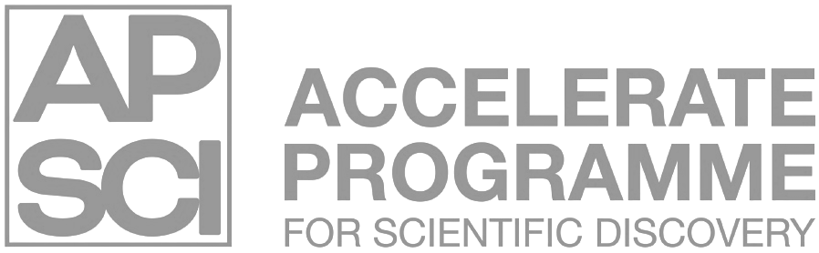

<!-- PROJECT LOGO -->
 

  

  <h3 align="center">Introduction to deep Generative AI and its applications</h3>
  

      This course offers an introduction to generative AI, from foundational concepts to state-of-the-art architectures and real-world applications. Participants will explore key approaches including Generative Adversarial Networks (GANs), Variational Autoencoders (VAEs), and Diffusion models. They will develop an understanding of how generative systems learn, how they produce new content, and how they can be applied responsibly to real-world challenges.
  

  

    <!-- <a href="https://github.com/acceleratescience/GenAI/" style="font-size: 20px; text-decoration: none"><strong>Start »</strong></a>
     
      -->
    <a href="https://github.com/acceleratescience/GenAI/blob/main/Introduction_to_Generative_AI.pdf">Check out the Slides</a>
  

<!-- LICENSE -->
## License

Distributed under a GNU GPL-3.0 License. See `LICENSE` for more information.

(<a href="#readme-top">back to top</a>)

